 <div align="center">


# AWS Infrastructure Deployment & Automation

### A Cloud Engineer Portfolio Project

**Infrastructure as Code · CI/CD · Networking · Containers · Database Automation · Resilience**

[](https://aws.amazon.com/)
[](https://developer.hashicorp.com/terraform)
[](https://aws.amazon.com/vpc/)
[](https://aws.amazon.com/ec2/)
[](https://aws.amazon.com/s3/)
[](https://aws.amazon.com/rds/)
[](https://www.mysql.com/)
[](https://docs.github.com/actions)
[](https://docs.github.com/actions/security-for-github-actions/security-hardening-your-deployments/about-security-hardening-with-openid-connect)
[](https://aws.amazon.com/iam/)
[](https://www.docker.com/)
[](https://aws.amazon.com/ecr/)
[](https://nodejs.org/)
[](https://expressjs.com/)
[](https://www.ansible.com/)

</div>

---

## 📌 Project Overview

This project demonstrates how cloud infrastructure, application deployment, configuration management, database integration, and operational testing can work together on Amazon Web Services (AWS).

The application uses **Node.js and Express**, is packaged with **Docker**, and is stored in **Amazon Elastic Container Registry (ECR)**. Terraform provisions the infrastructure, Ansible manages server configuration, and GitHub Actions automates deployment and operational workflows.

Amazon RDS for MySQL provides persistent user data storage. Amazon S3 connects to the database through automated workflows that import CSV records and export database data. An active-passive failover test checks application recovery when the primary application's container becomes unavailable.

### What makes this project different?

| Engineering area | What this project demonstrates |
|---|---|
| Infrastructure | Terraform-managed AWS resources and remote state |
| Configuration | Ansible-based server configuration |
| Deployment | GitHub Actions, OIDC, Docker, and Amazon ECR |
| Application | Node.js, Express, and HTTP endpoints |
| Database | Persistent user records in Amazon RDS for MySQL |
| Data operations | Automated S3-to-RDS imports and RDS-to-S3 exports |
| Resilience | Nginx routing and application-container failover testing |
| Security | IAM roles, federated authentication, and network access controls |

---

## 🧰 Technology Stack

| Technology | Purpose |
|---|---|
| **Amazon Web Services (AWS)** | Cloud infrastructure and managed services |
| **Amazon VPC** | Network isolation and subnet organization |
| **Amazon EC2** | Application hosting |
| **Amazon RDS for MySQL** | Persistent relational database |
| **Amazon S3** | CSV imports and exported database data |
| **Amazon ECR** | Private Docker image registry |
| **AWS IAM, OIDC and STS** | Identity, authentication, and access control |
| **Terraform** | Infrastructure as Code |
| **Ansible** | Server configuration and deployment tasks |
| **GitHub Actions** | CI/CD and operational automation |
| **Docker** | Application containerization |
| **Node.js and Express** | Application runtime and HTTP routes |
| **Nginx** | Reverse proxy and application traffic routing |
| **MySQL** | Relational database engine |

---

## 🗂️ Project Structure

```text
Infra-deploy-aws-2/
├── .github/
│   └── workflows/
│       ├── deploy.yml
│       ├── failover-test.yml
│       ├── s3-import.yml
│       └── s3-export.yml
├── ansible/
│   ├── ansible-deploy.yml
│   ├── ansible.cfg
│   ├── generate-inventory.sh
│   ├── prepare-ssh.sh
│   └── templates/
│       └── nginx.conf.j2
├── docs/
│   ├── assets/
│   │   └── animations/
│   └── screenshots/
├── nodeapp/
│   ├── app.js
│   ├── Dockerfile
│   ├── package.json
│   └── public/
├── terraform/
│   ├── iam_s3.tf
│   ├── main.tf
│   ├── rds.tf
│   ├── variables.tf
│   └── .terraform.lock.hcl
├── users.csv
├── .gitignore
├── .gitattributes
└── README.md
```

---

## ☁️ AWS Architecture

<p align="center">
  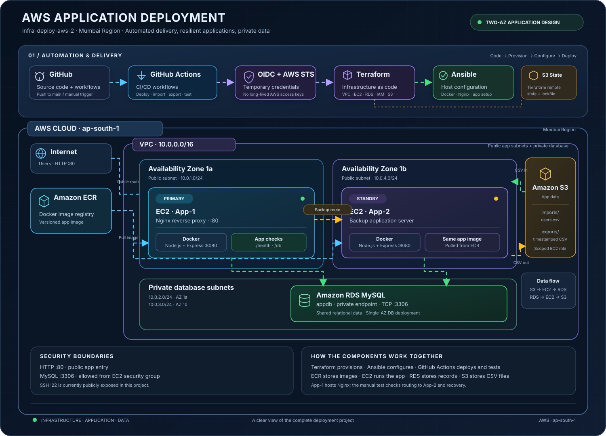
</p>

<p align="center"><em>Figure 1 — AWS network, application, database, and supporting services.</em></p>

The application runs on two EC2 instances in a custom VPC. The application tier connects to Amazon RDS for MySQL in private subnets. Amazon ECR stores container images, while Amazon S3 stores files used for database import and export operations.

Terraform provisions the infrastructure, Ansible configures the servers, and GitHub Actions coordinates deployment and operational workflows.

### Component responsibilities

| Component | Responsibility |
|---|---|
| **Amazon VPC** | Isolated project network |
| **Public subnets** | Application EC2 instances |
| **Private subnets** | RDS network placement |
| **Amazon EC2** | Application containers and supporting services |
| **Security groups** | Network traffic controls |
| **Amazon RDS** | Persistent user records |
| **Amazon S3** | Import and export files |
| **Amazon ECR** | Container image storage |
| **AWS IAM** | Resource access permissions |
| **GitHub Actions** | Deployment and operational workflows |

### Infrastructure in AWS

<p align="center">
  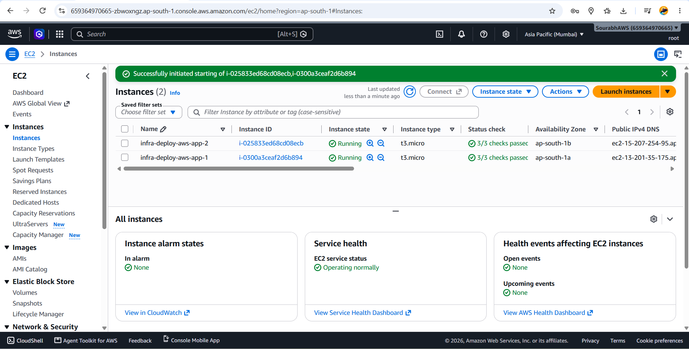
</p>

<p align="center"><em>Figure 2 — Application instances in the Amazon EC2 console.</em></p>

---

## 🏗️ Terraform Infrastructure

<p align="center">
  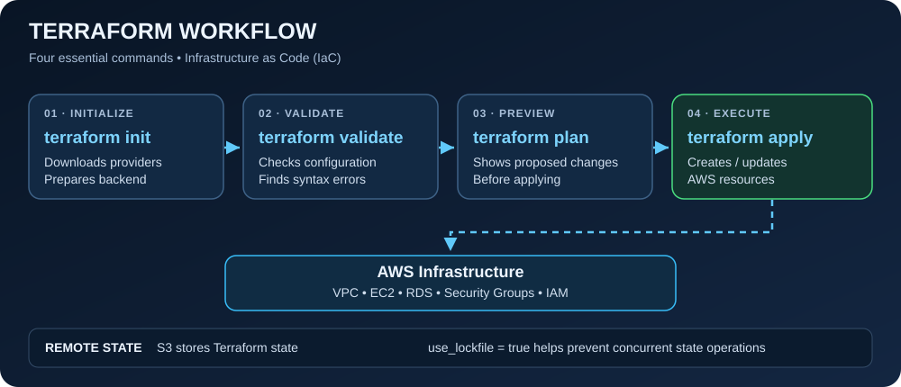
</p>

<p align="center"><em>Infrastructure provisioning with Terraform.</em></p>

Terraform manages the project's VPC, subnets, networking, security groups, EC2 resources, RDS, and relevant IAM permissions.

### Remote state management

Terraform state is stored in an Amazon S3 backend.

| Setting | Configuration |
|---|---|
| **S3 bucket** | `infra-deploy-aws-2-terraform-state-2026` |
| **State key** | `terraform.tfstate` |
| **State locking** | `use_lockfile = true` |
| **State protection** | Versioning, encryption, and Block Public Access |

Remote state provides a shared record of managed infrastructure. State locking helps prevent conflicting Terraform operations from modifying the state simultaneously.

### Common Terraform commands

Run these commands from the `terraform/` directory.

```bash
terraform init
terraform validate
terraform plan
terraform apply
```

- `terraform init` — initializes the working directory and backend.
- `terraform validate` — checks the configuration for errors.
- `terraform plan` — previews proposed infrastructure changes.
- `terraform apply` — applies the proposed changes after confirmation.

The deployment workflow also runs Terraform. Review proposed changes carefully before applying them.

---

## ⚙️ Ansible Configuration Management

<p align="center">
  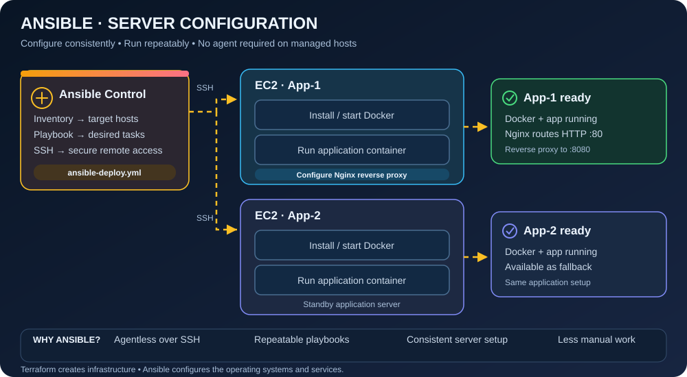
</p>

<p align="center"><em>Automating server configuration and deployment tasks.</em></p>

Ansible manages server configuration and deployment tasks after infrastructure provisioning.

- **Terraform** creates and manages the infrastructure.
- **Ansible** configures software and services on the servers.

The Ansible playbook handles the required configuration and deployment tasks. Supporting files manage playbook settings, SSH preparation, dynamic inventory generation, and Nginx configuration.

Keeping these responsibilities separate makes the deployment process easier to maintain and troubleshoot.

---

## 🔄 CI/CD and Deployment

<p align="center">
  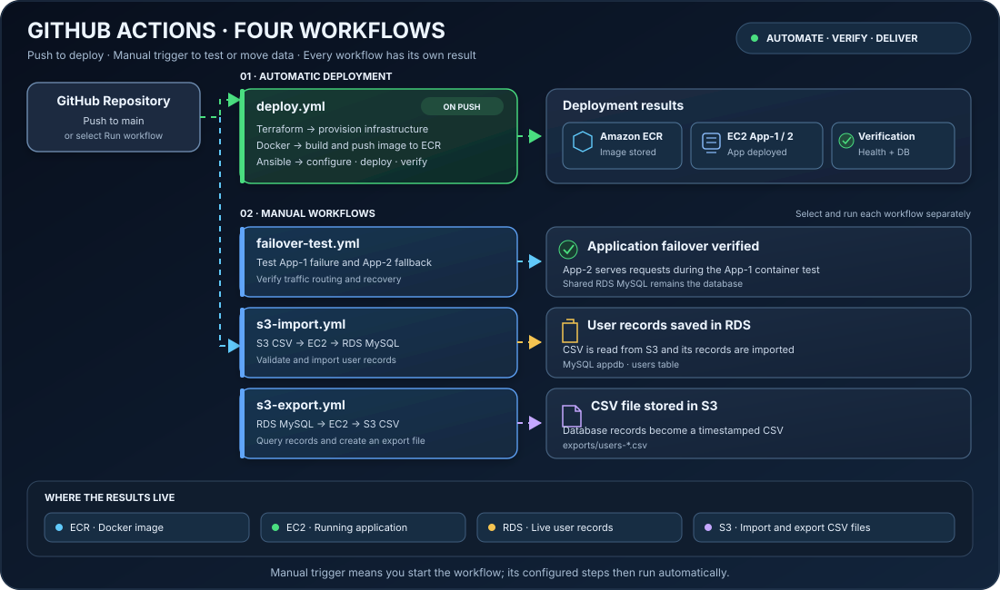
</p>

<p align="center"><em>From repository changes to an application deployed on AWS.</em></p>

GitHub Actions automates application deployment. The workflow uses GitHub OIDC federation to obtain AWS credentials through an IAM role instead of depending on long-lived AWS access keys stored as GitHub Actions credentials.

### Deployment workflow

1. Initializes and validates Terraform configuration.
2. Plans and applies infrastructure changes.
3. Checks required infrastructure and database availability.
4. Builds the Docker image and pushes it to Amazon ECR.
5. Discovers application instances and prepares deployment inventory.
6. Uses Ansible for server configuration and deployment tasks.
7. Configures Nginx and verifies the deployed application.
8. Performs the configured post-deployment instance-state operations.

### Run the deployment workflow

1. Open the repository on GitHub.
2. Select **Actions**.
3. Open the **Deploy** workflow.
4. Select **Run workflow** if manual execution is available.
5. Select the `main` branch and start the workflow.
6. Inspect the job results and logs.

The workflow may also run automatically when its configured trigger conditions are met.

**Workflow:** [Open Deploy workflow](https://github.com/Saurabhdhule0108/Infra-deploy-aws-2/actions/workflows/deploy.yml)

### Deployment evidence

<p align="center">
  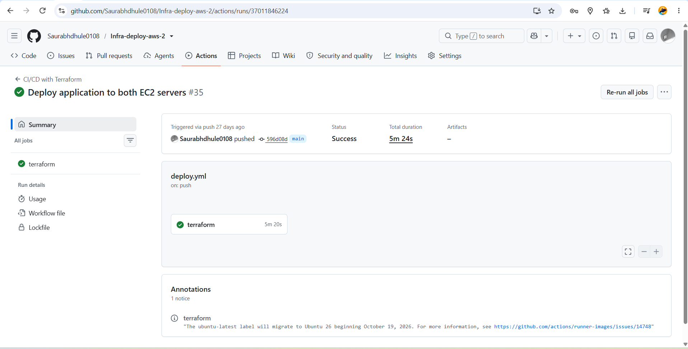
</p>

<p align="center"><em>Figure 3 — A successful deployment workflow run.</em></p>

---

## 🐳 Docker and Amazon ECR

<p align="center">
  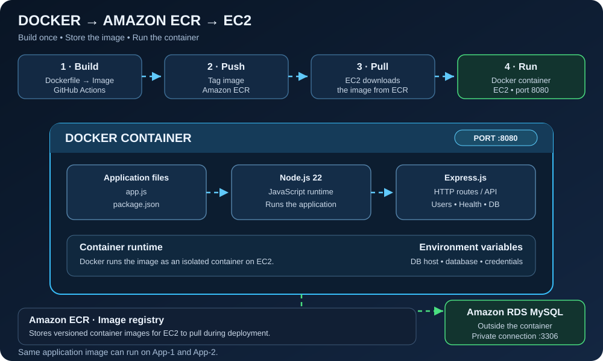
</p>

<p align="center"><em>Building, publishing, and deploying the application container.</em></p>

Docker packages the Node.js application and its runtime dependencies into a container image. Amazon ECR provides a private registry for storing the images produced by the deployment workflow.

The workflow builds the application image, pushes it to the `infra-deploy-aws-app` repository, and deploys it to the application servers.

The application container listens on port `8080`. The configured web entry point and Nginx routing expose the application through HTTP port `80`.

### Container registry evidence

<p align="center">
  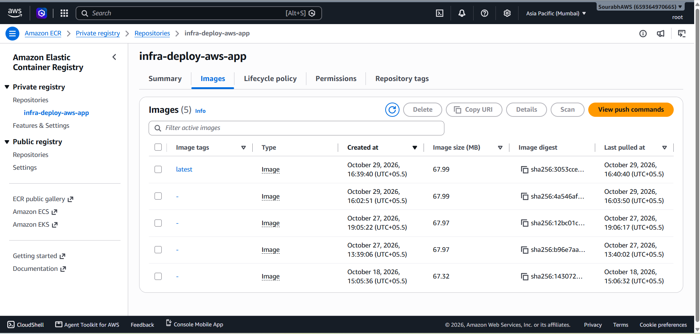
</p>

<p align="center"><em>Figure 4 — The application image stored in Amazon ECR.</em></p>

---

## 🗄️ Application and RDS Integration

<p align="center">
  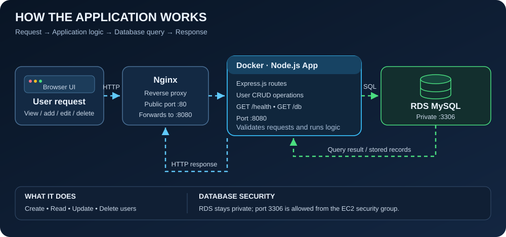
</p>

<p align="center"><em>Application requests connected to persistent database storage.</em></p>

The Node.js and Express application serves the web interface and handles HTTP requests. Amazon RDS for MySQL stores user records independently of the application container, allowing the data to persist when containers are redeployed.

### Application endpoints

| Endpoint | Purpose |
|---|---|
| `GET /health` | Checks application health and reports the serving hostname |
| `GET /db` | Checks database connectivity |
| `/users` | Supports the user operations implemented by the application |

The database is named `appdb`, and the application uses the `users` table. Security groups restrict MySQL access to the application EC2 security group rather than exposing the database publicly.

### Running application

<p align="center">
  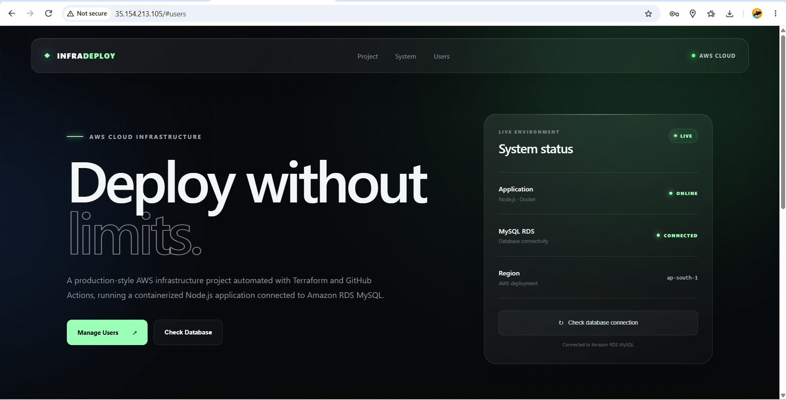
</p>

<p align="center"><em>Figure 5 — The deployed application running in the browser.</em></p>

### User records retrieved from RDS

<p align="center">
  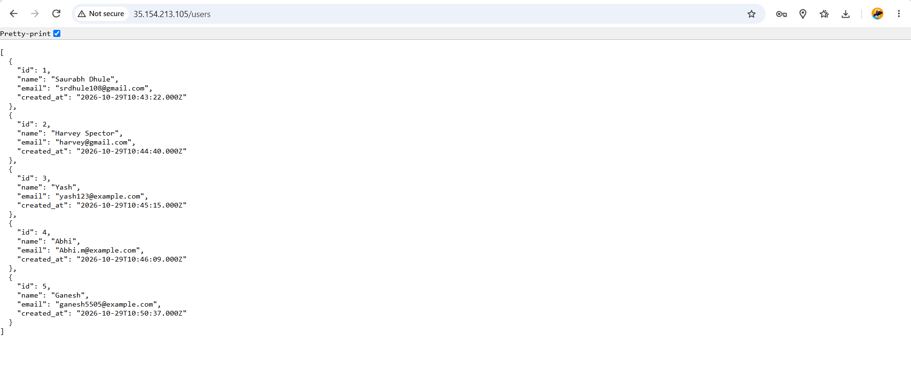
</p>

<p align="center"><em>Figure 6 — User records retrieved through the application.</em></p>

### What this integration demonstrates

- Persistent data storage using a managed relational database.
- Application-to-database connectivity.
- Separation between application and data tiers.
- Database connectivity checks and operational troubleshooting.

---

## 🔄 S3 and RDS Data Automation

<p align="center">
  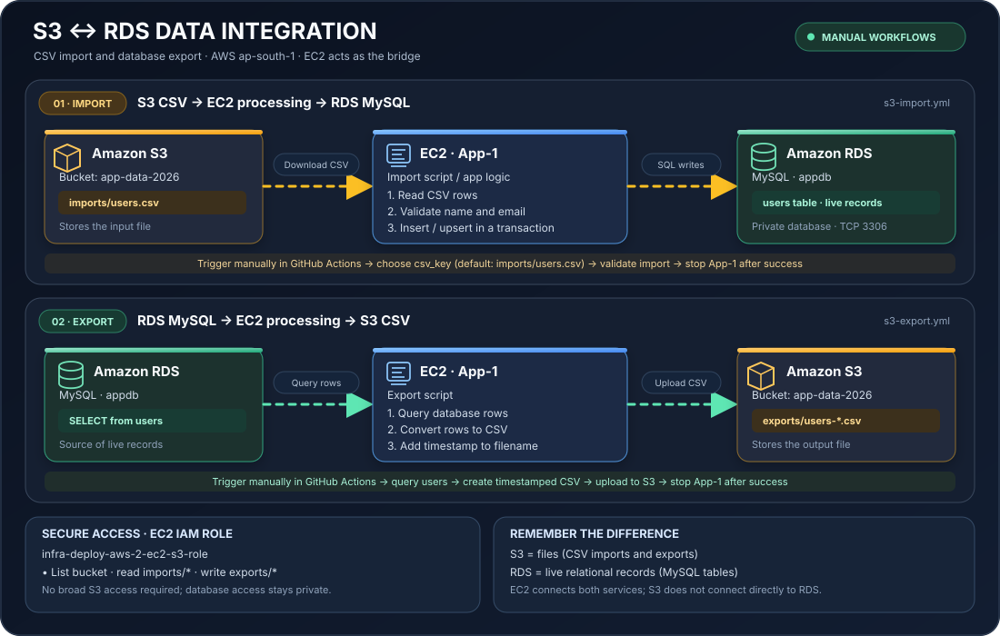
</p>

<p align="center"><em>CSV data moving from S3 into RDS and database records being exported back to S3.</em></p>

Amazon S3 stores CSV files used to import records and files generated when exporting records from RDS. EC2 acts as the bridge between S3 and RDS MySQL during these operations.

### Import — S3 to RDS

1. Place a CSV file in the bucket's `imports/` prefix.
2. Run the S3 import workflow from GitHub Actions.
3. The workflow uses the application server to download the CSV file.
4. It validates the expected `name` and `email` fields.
5. It imports records into `appdb.users` using a transaction and insert-or-update behavior.
6. It verifies the import result.

### Export — RDS to S3

1. Run the S3 export workflow from GitHub Actions.
2. The workflow queries records from `appdb.users`.
3. It generates a timestamped CSV file.
4. It uploads the file to the bucket's `exports/` prefix.
5. It verifies that the export operation completed.

### Data bucket

| Setting | Value |
|---|---|
| **Bucket** | `infra-deploy-aws-2-app-data-2026` |
| **Import prefix** | `imports/` |
| **Export prefix** | `exports/` |
| **EC2 IAM role** | `infra-deploy-aws-2-ec2-s3-role` |

The EC2 IAM role is intended to restrict access to the required data operations, including reading import files and writing export files.

### Import and export evidence

<p align="center">
  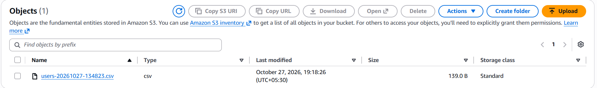
</p>

<p align="center"><em>Figure 7 — The S3 bucket and its import and export data.</em></p>

### Run the data workflows

- [S3 Import Workflow](https://github.com/Saurabhdhule0108/Infra-deploy-aws-2/actions/workflows/s3-import.yml)
- [S3 Export Workflow](https://github.com/Saurabhdhule0108/Infra-deploy-aws-2/actions/workflows/s3-export.yml)

Open the required workflow, select **Run workflow** when available, provide any required inputs, and inspect the execution logs.

---

## 🛡️ Active-Passive Failover Testing

<p align="center">
  
</p>

<p align="center"><em>Testing application recovery when the primary container becomes unavailable.</em></p>

The project includes a manual GitHub Actions workflow that tests application-level failover between the primary and secondary application servers.

### Failover test sequence

1. Checks the normal application and database paths.
2. Stops the Node.js application container on App-1 while leaving its EC2 instance and Nginx running.
3. Verifies that the primary application path becomes unavailable.
4. Checks that Nginx routes application requests to App-2.
5. Verifies database connectivity through the application.
6. Restores the App-1 container and checks recovery.

### Run the failover test

1. Open GitHub Actions in the repository.
2. Select the **Failover Test** workflow.
3. Choose **Run workflow** if manual execution is available.
4. Monitor the test steps and inspect the failover and recovery results.

**Workflow:** [Open Failover Test workflow](https://github.com/Saurabhdhule0108/Infra-deploy-aws-2/actions/workflows/failover-test.yml)

> **Current limitation:** This tests application-container failover, not automated EC2 host replacement or Availability Zone failover. Nginx is configured on App-1, so the design does not provide a fully redundant load-balancing tier.

---

## 🔐 Security and IAM

Security controls are applied across infrastructure provisioning, deployment, application networking, and data access.

| Area | Implementation |
|---|---|
| **GitHub-to-AWS authentication** | OIDC federation with an IAM role |
| **AWS credentials** | Avoids long-lived AWS access keys for GitHub Actions authentication |
| **Database access** | MySQL traffic is restricted to the application EC2 security group |
| **RDS exposure** | RDS is configured without public accessibility |
| **Terraform state** | S3 versioning, encryption, and Block Public Access |
| **S3 application data** | Dedicated bucket and EC2 IAM role for required data operations |
| **Container registry** | Amazon ECR image scanning on push is enabled |

The GitHub Actions IAM role is `GitHubActions-InfraDeployAWS`. The EC2 S3 role is `infra-deploy-aws-2-ec2-s3-role`.

> **Security hardening to address:** The current EC2 security group includes SSH access from `0.0.0.0/0`. Restrict SSH to approved administration sources or adopt a controlled management approach before treating the design as production-hardened.

---

## 🚀 Limitations and Future Improvements

The current implementation demonstrates several cloud engineering workflows. The following improvements could strengthen its availability, security, testing, and observability.

- **Application Load Balancer (ALB):** Introduce a dedicated load-balancing layer with health checks and traffic distribution.
- **Auto Scaling Group (ASG):** Automate EC2 replacement and application-tier capacity management.
- **Host-level resilience:** Extend failover to address EC2 instance and Availability Zone failures.
- **Automated testing:** Add unit and integration tests to the CI/CD pipeline before deployment.
- **Monitoring and alerting:** Add CloudWatch metrics, logs, alarms, and operational notifications.
- **Secrets management:** Improve database credential handling with managed secrets and controlled rotation.
- **Network security:** Restrict SSH access and review security group rules using least-privilege principles.
- **HTTPS:** Configure TLS for encrypted application access.
- **Database availability and recovery:** Evaluate RDS Multi-AZ, backup retention, and tested recovery procedures.
- **Deployment resilience:** Improve rollback handling when an intermediate deployment step fails.

These are future improvements, not features claimed as already implemented.

---

<div align="center">

## AWS Infrastructure Deployment & Automation

**Build it. Automate it. Verify it. Improve it.**

</div>

---

