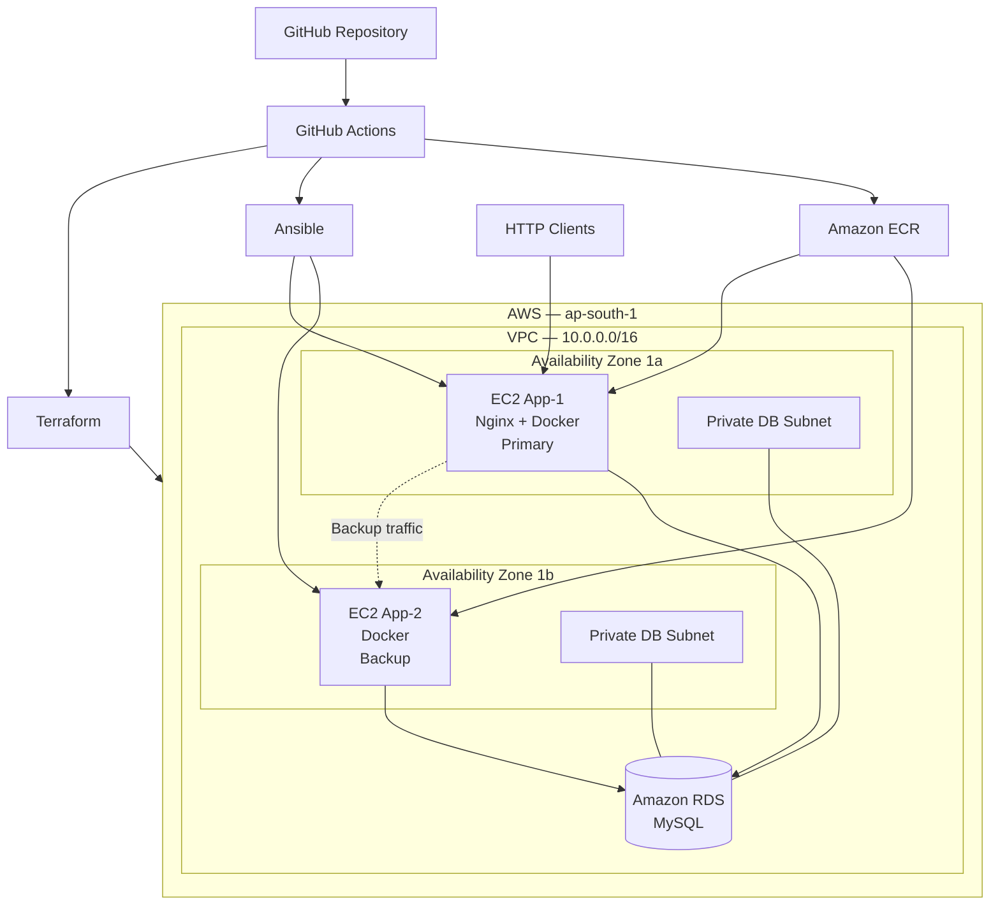
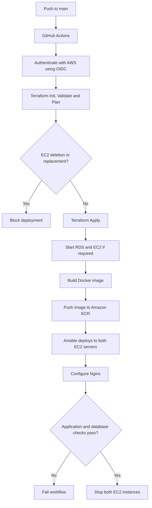
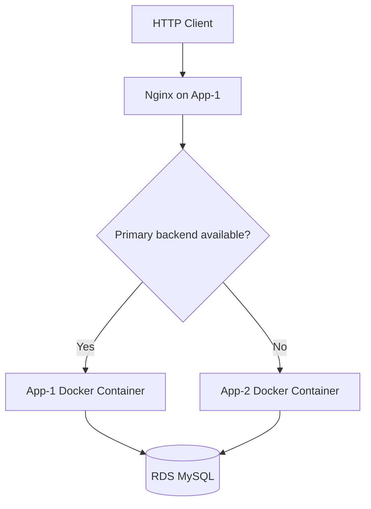

# AWS Infrastructure Automation & CI/CD

**Terraform | GitHub Actions | Ansible | Docker | Amazon ECR | Nginx | Amazon RDS MySQL**

An end-to-end AWS cloud infrastructure project demonstrating automated infrastructure provisioning, secure CI/CD, containerized application deployment, configuration management, and application-level active-passive failover.

The project uses two EC2 application servers across different Availability Zones and a private MySQL database. GitHub Actions coordinates Terraform, Docker, and Ansible to provision, configure, deploy, and verify the environment.

## Key Features

- Infrastructure as Code with Terraform
- Automated CI/CD through GitHub Actions
- AWS authentication using OIDC and temporary STS credentials
- Two EC2 application servers across two Availability Zones
- Docker image delivery through Amazon ECR
- Automated server configuration and deployment with Ansible
- Nginx reverse proxy with active-passive application routing
- Private Amazon RDS MySQL integration
- Terraform remote state in Amazon S3 with locking
- Protection against accidental EC2 deletion or replacement
- Automated application failover and recovery testing
- Cost-aware EC2 start/stop automation

## 1. Architecture



**Environment**

| Configuration | Value |
|---|---|
| AWS Region | `ap-south-1` — Mumbai |
| VPC CIDR | `10.0.0.0/16` |
| Primary server | EC2 App-1, `ap-south-1a` |
| Backup server | EC2 App-2, `ap-south-1b` |
| Database | Private Amazon RDS MySQL |
| Container registry | Amazon ECR |
| Terraform backend | Amazon S3 |

Both application servers are deployed in public subnets. RDS uses a DB subnet group spanning two private subnets, but the database itself is configured as **Single-AZ**, not Multi-AZ.

## 2. CI/CD Deployment Pipeline

The main deployment workflow is located at:

`.github/workflows/deploy.yml`

A push to the `main` branch triggers the pipeline.



The pipeline automatically:

1. Authenticates with AWS using GitHub OIDC.
2. Initializes, validates, and plans Terraform changes.
3. Blocks EC2 deletion or replacement operations.
4. Applies approved infrastructure changes.
5. Ensures the required database and application instances are running.
6. Builds and pushes the application image to ECR.
7. Uses Ansible to configure both EC2 servers and deploy the application.
8. Configures Nginx on the primary server.
9. Verifies application availability and database connectivity.
10. Stops both EC2 instances after successful deployment.

If deployment fails after the instances are started, the final success-only stop step is not executed.

## 3. Terraform — Infrastructure as Code

Terraform manages the AWS infrastructure, including:

- VPC, subnets, route tables, and Internet Gateway
- EC2 application servers
- Security groups
- Amazon ECR repository
- RDS DB subnet group and MySQL instance

### Terraform State

Terraform state is stored remotely in Amazon S3 with:

- S3 bucket versioning
- Server-side encryption
- Public access blocking
- State locking

Remote state enables GitHub Actions to manage the same infrastructure consistently across workflow runs.

### EC2 Protection

Both EC2 resources use Terraform lifecycle protection:

```hcl
lifecycle {
  prevent_destroy = true
}
```

The deployment workflow also inspects the Terraform plan and blocks operations that would delete or replace an EC2 instance.

This protects the existing application servers from accidental replacement during automated deployments.

## 4. Ansible — Configuration Management

Ansible manages application server configuration and deployment.

**Playbook:** `ansible/ansible-deploy.yml`

Ansible is responsible for:

- Installing Docker on Ubuntu EC2 instances
- Starting and enabling Docker
- Authenticating with Amazon ECR
- Pulling the application image
- Deploying Docker containers on both EC2 instances
- Passing database configuration to the containers
- Installing and configuring Nginx on App-1
- Validating application availability

Terraform manages the infrastructure, while Ansible manages the configuration and application deployment on that infrastructure.

### Verified Ansible Results

| Server | OK | Changed | Failed | Unreachable |
|---|---:|---:|---:|---:|
| App-1 | 19 | 3 | 0 | 0 |
| App-2 | 10 | 3 | 0 | 0 |

Both application servers completed the Ansible deployment successfully.

## 5. Docker and Amazon ECR

The Node.js application is packaged into a Docker image using `nodeapp/Dockerfile`.

The GitHub Actions workflow builds the image and pushes it to Amazon ECR. Ansible then pulls and runs the image on both EC2 instances.

The application listens on container port `8080`.

**Important distinction:** ECR stores container images. Docker running on EC2 executes the containers.

## 6. Private RDS MySQL Integration

The application uses Amazon RDS for MySQL.

| Setting | Configuration |
|---|---|
| Database name | `appdb` |
| Database engine | MySQL |
| Public accessibility | Disabled |
| Database port | `3306` |
| Deployment | Single-AZ |
| Connectivity | Private VPC network |

The RDS security group allows MySQL traffic from the EC2 application security group.

The database password is provided through a GitHub Actions secret rather than being committed to the repository.

The application exposes a `/db` endpoint to verify connectivity to MySQL.

## 7. Nginx Active-Passive Failover

Nginx runs on App-1 and forwards application traffic to the primary Docker container.

The backup backend is the Docker container running on App-2, reached through its private IP address.



### Automated Failover Test

**Workflow:** `.github/workflows/failover-test.yml`

This workflow runs manually through GitHub Actions.

It performs the following sequence:

1. Starts the required infrastructure.
2. Verifies App-1 serves application traffic.
3. Identifies the primary and backup container hostnames.
4. Stops the primary Docker container on App-1.
5. Confirms Nginx routes requests to App-2.
6. Verifies database connectivity through the backup.
7. Restarts the primary container.
8. Verifies primary routing and application recovery.

The `/health` endpoint returns the hostname of the container serving the request, allowing the workflow to verify which backend handled the request.

### Failover Verification

| Phase | Expected backend |
|---|---|
| Normal operation | App-1 |
| Primary container failure | App-2 |
| Primary recovery | App-1 |

**Test result:** The automated failover workflow completed successfully.

### Architecture Limitation

This project demonstrates **application-level active-passive failover**, not full EC2 high availability.

Nginx runs on App-1. If the entire App-1 EC2 instance becomes unavailable, the public Nginx entry point is also unavailable.

A production-oriented improvement would be to introduce an Application Load Balancer and an appropriate multi-instance architecture.

## 8. Security

The project incorporates several security controls:

| Area | Implementation |
|---|---|
| AWS authentication | GitHub OIDC and temporary STS credentials |
| Database | Private RDS with restricted security group access |
| Secrets | GitHub Actions Secrets |
| Terraform state | S3 encryption, versioning, and locking |
| Infrastructure protection | Terraform lifecycle protection and plan safety gate |
| Container images | Amazon ECR |

Security hardening opportunities include restricting administrative access further, adopting Systems Manager for instance management, and enabling HTTPS.

## 9. Repository Structure

```text
.
├── .github/
│   └── workflows/
│       ├── deploy.yml
│       └── failover-test.yml
├── ansible/
│   ├── ansible-deploy.yml
│   ├── generate-inventory.sh
│   ├── prepare-ssh.sh
│   └── templates/
│       └── nginx.conf.j2
├── nodeapp/
│   ├── public/
│   ├── app.js
│   ├── Dockerfile
│   └── package.json
├── terraform/
│   ├── main.tf
│   ├── rds.tf
│   ├── variables.tf
│   └── .terraform.lock.hcl
└── README.md
```

## 10. Running the Workflows

### Main Deployment

Push changes to `main` to trigger the deployment workflow.

The workflow may provision AWS resources, including recreating an RDS database that has been manually deleted.

### Failover Test

Navigate to:

**GitHub → Actions → Active-Passive Failover Test → Run workflow**

The test starts the required instances, performs failover and recovery verification, and leaves both EC2 instances running for inspection.

### Cost Considerations

This project is a learning and portfolio environment. The normal deployment stops EC2 instances after successful verification to reduce compute costs.

The failover test leaves EC2 instances running. RDS, storage, and other AWS resources may continue to incur charges.

Resources should be reviewed and stopped or deleted when not required.

## 11. Verified Project Outcomes

- Terraform infrastructure deployment completed successfully.
- Existing EC2 instances were preserved without replacement.
- Ansible successfully configured both application servers.
- Docker images were delivered through Amazon ECR.
- Application and RDS connectivity checks passed.
- Automated application-level failover and recovery testing passed.
- Both GitHub Actions workflows completed successfully.

## 12. Future Improvements

Potential production-focused enhancements include:

- Application Load Balancer
- Auto Scaling Group
- Private application subnets
- AWS Systems Manager
- HTTPS and AWS Certificate Manager
- Amazon Route 53
- RDS Multi-AZ deployment
- CloudWatch monitoring and alerting
- More restrictive IAM and network permissions
- Separate development, staging, and production environments

---

**Project Focus:** Cloud Infrastructure Engineering · Infrastructure as Code · CI/CD Automation · Configuration Management · Application Resilience